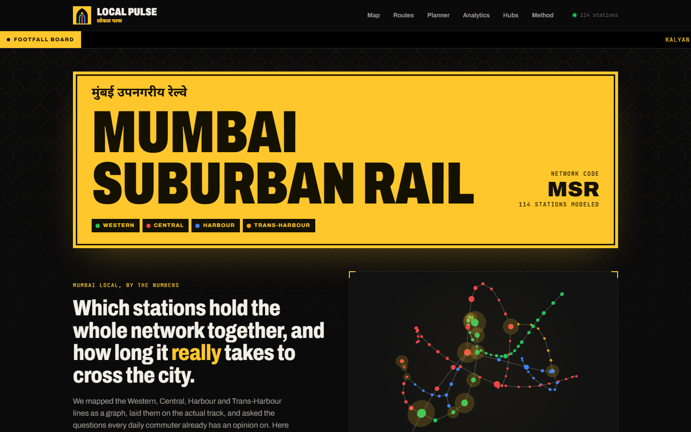
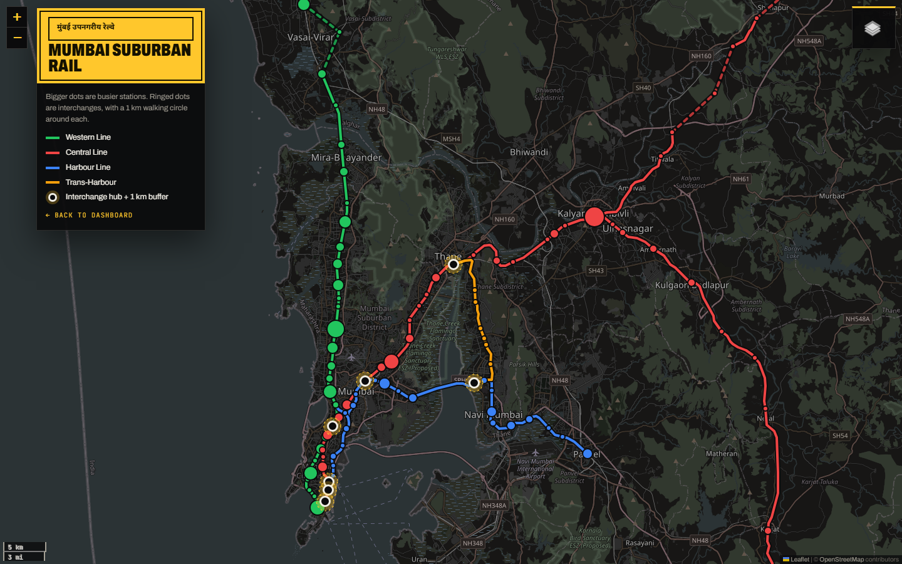
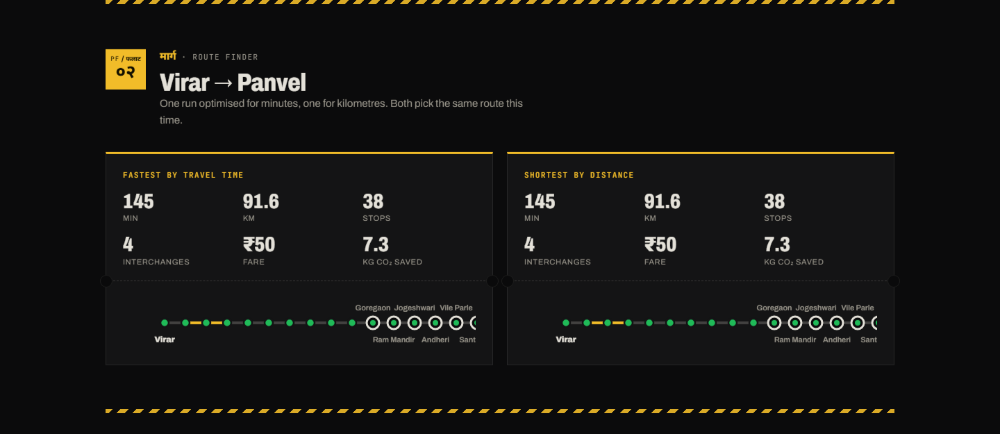
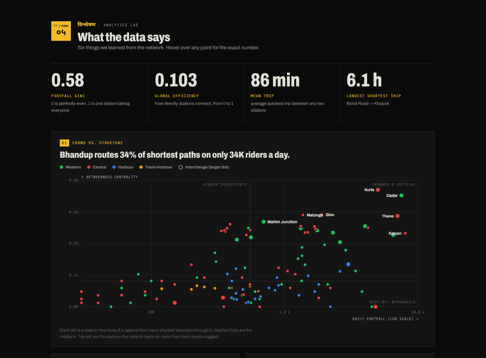
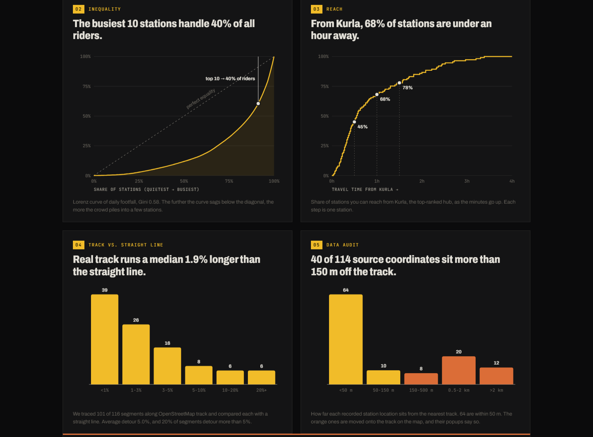
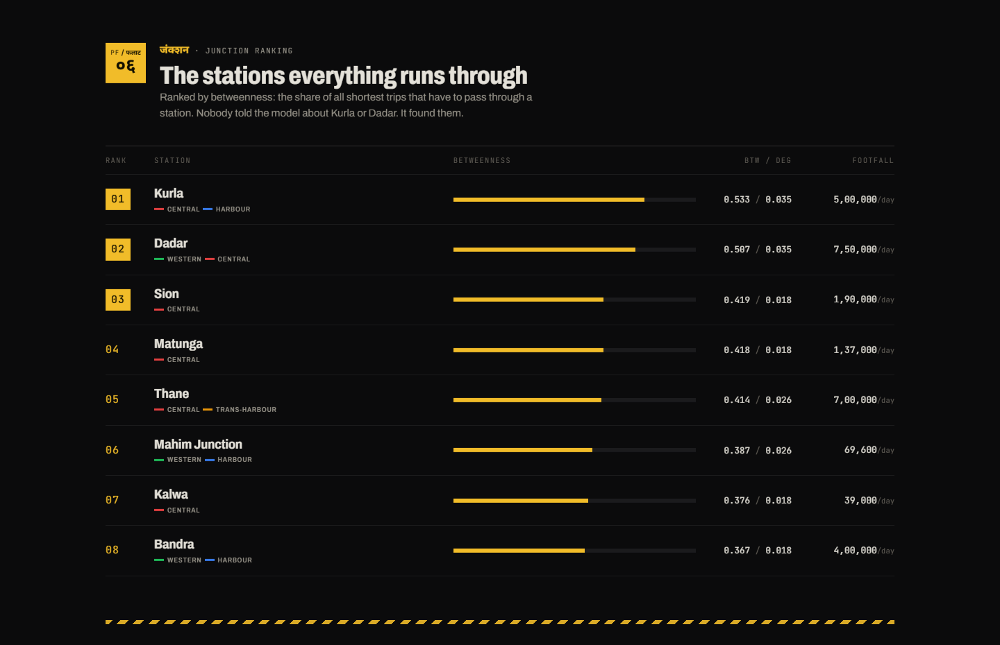

# Local Pulse: Mumbai Suburban Rail Analytics

A data science project on the Mumbai local train network. It turns 114 stations
on the Western, Central, Harbour and Trans-Harbour lines into a graph, finds the
stations the whole system depends on, plans routes, draws everything on the real
track, and puts it all in one dashboard.

**Live: [jehdadina-jpg.github.io/dsmp](https://jehdadina-jpg.github.io/dsmp/)**



## What's in it

**An interactive map** with every line drawn along its actual track (from
OpenStreetMap), stations sized by daily footfall, and a 1 km walking circle
around each interchange.



**Route finder and trip planner.** Dijkstra's algorithm gives the fastest and
the shortest route between any two stations, with fare, number of changes and
CO₂ saved compared to driving. The planner runs in the browser.



**An analytics section** with six findings the pipeline works out every run:

- The busiest 10 stations handle about 40% of all riders (Gini 0.58).
- From Kurla, the most central hub, 68% of stations are under an hour away.
- Real track is a median 1.9% longer than a straight line between stations.
- 76 of 114 stations are single points of failure: close one and the network splits.
- 40 station coordinates in the source data sit more than 150 m off the track.
- A crowd vs. importance chart that shows stations like Bhandup carrying far
  more through-traffic than their crowds suggest.




**A junction ranking** by betweenness centrality. Nobody told the model which
stations matter; Kurla, Dadar and Thane come out on top on their own.



## Run it

You need Python 3.11 or newer.

```bash
python -m venv .venv
.venv\Scripts\activate          # Windows
source .venv/bin/activate       # macOS / Linux
pip install -r requirements.txt

python main.py --full
```

Then open `output/dashboard.html`. Run `python main.py` without `--full` for
an interactive menu, or pick your own example route:

```bash
python main.py --full --origin Andheri --destination Kalyan
```

Tests:

```bash
pip install -r requirements-dev.txt
pytest
```

## How it works

| Step | Tools | What happens |
|---|---|---|
| Load and clean | pandas | Station and edge tables, duplicate checks, haversine distances |
| Graph | networkx | Shortest routes, centrality, reach, resilience, inequality |
| Track geometry | OpenStreetMap, scipy | Each segment routed along the real rails |
| GIS | geopandas, shapely | 1 km walking buffers, GeoJSON for QGIS |
| Output | folium, three.js | The map and the dashboard |

The OpenStreetMap track data is downloaded once and saved in
`data/raw/osm_rail.json`, so later runs work offline. A `.cypher` file for
loading the graph into Neo4j is also written to `data/processed/`
(`python main.py --full --push-neo4j` pushes it to a running instance).

```
main.py                  run everything
src/data_loader.py       station and edge data, cleaning
src/graph_analytics.py   routing, centrality and the analytics numbers
src/track_geometry.py    snapping the network onto real track
src/spatial_analysis.py  buffers, GeoJSON, the map
src/dashboard.py         the dashboard page
src/dashboard_charts.py  the charts on it
tests/                   pytest checks
```

## About the data

- Station names, lines and order come from Wikipedia. Coordinates come from each
  station's Wikipedia page.
- Footfall for Kalyan (8 lakh a day) and Borivali (2.87 lakh a day) is from
  published figures. The rest are estimates based on each station's role, because
  Indian Railways doesn't publish station-wise counts. Swap in real numbers in
  `src/data_loader.py` and everything downstream updates.
- Travel times assume an average of 38 km/h including stops. They're not from
  the timetable.
- Some outer-branch coordinates are a few km off. The map moves those stations
  onto the track and draws their segments dashed, and the data audit chart
  counts them.
